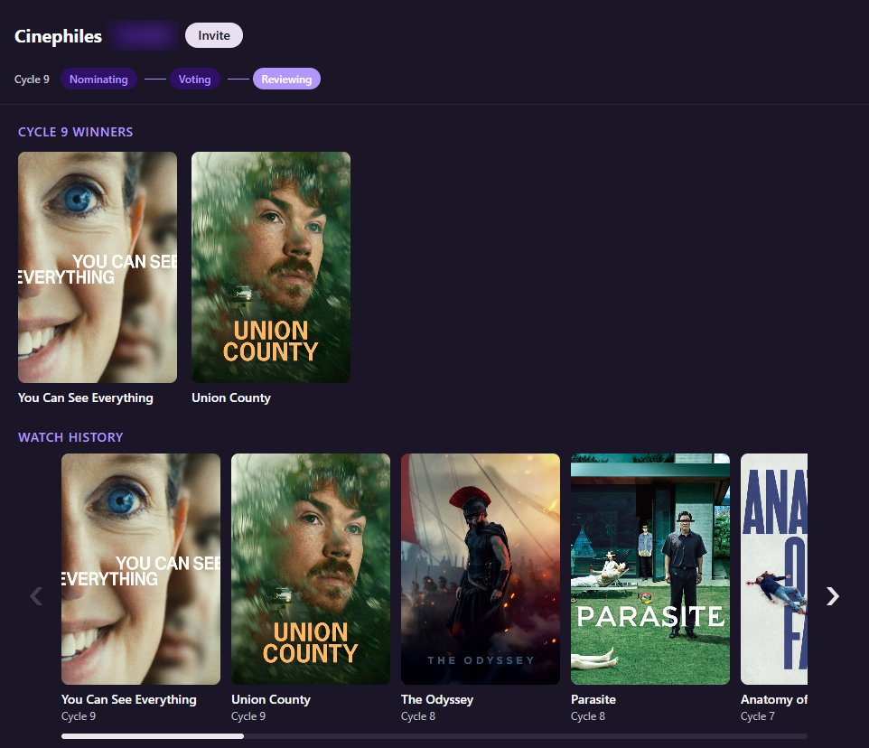

# Harshad Bhojan

Software Engineer at Capital One · M.S. CS student at Georgia Tech · B.S.E. CS, University of Michigan

[bhojanha@umich.edu](mailto:bhojanha@umich.edu) · [LinkedIn](https://www.linkedin.com/in/harshad-bhojan) · [GitHub](https://github.com/bhojanha17)

I'm passionate about backend services and distributed systems. Most recently I helped deliver Capital One's first company-owned scan gate for third-party container images, a multi-region serverless pipeline on AWS that certifies about 4,000 images a day. My work also spans Java/Spring Boot services, ML models for security data, and systems projects in Go and C++: Paxos, MapReduce, thread libraries, and virtual memory.

---

## Live projects

**[Cinephiles](https://cinephilesclub.com)**: a movie club app for friend groups. Members nominate films, rank them to pick the club's next watch, and review what they've seen. An AI assistant built on Claude recommends movies and checks every pick against real TMDB data.

---

## Experience

### Capital One — Associate Software Engineer
*New York, NY · August 2025 – Present*

**Artifactory Curation**
- Delivered Capital One's first company-owned Qualys scan gate for third-party container images: a six-stage, multi-region serverless pipeline (AWS Lambda, SQS, DynamoDB Global Tables, CDK) that certifies 100% of ~4,000 images a day and cut P95 availability time from 27.5 hours to 11 minutes (~99%).
- Led the production infrastructure buildout across two AWS regions, provisioning cross-account SQS queues and KMS keys, setting up gradual deployments with automatic rollback, and resolving the CloudFormation and OnePipeline failures that blocked the first prod release.
- Instrumented end-to-end observability by standardizing logs from all six stages into Splunk for single-ID tracing, then drove the move to Observe with an OPAL dashboard of pipeline metrics.

**Smart Doc Upload**
- Built features and enhancements for **Smart Doc Upload**, a set of Java Spring Boot REST APIs with MongoDB storage that ingests 1,000,000+ sensitive customer documents a day. The service publishes event-based updates to Kafka, Snowflake, and OneLake for downstream clients.
- Co-led architecture design for the **Insights Processing Engine**, an AI-driven service that extracts real-time insights from customer documents. Wrote the workflow ADRs, API contracts, and schemas from business requirements.
- Onboarded 30+ use cases across 5+ client teams, testing end-to-end in QA and production. Built a Claude Code skill that automates onboarding, cutting turnaround from 20 minutes to 20 seconds.
- Shipped production builds through a CI/CD pipeline to Linux-based AWS ECS Docker containers. Monitored application health in New Relic and Splunk and remediated security vulnerabilities.

**Across the company**
- Gave an organization-wide demo on bringing Claude Code into the corporate development workflow, which helped engineering teams adopt AI-assisted development.
- Mentored middle school students in the Coders program as they built, tested, and deployed apps with MIT App Inventor.

### Nokia — AI Solutions Engineer Intern
*Naperville, IL · June 2024 – August 2024*

- Trained a neural network that classifies 1,000,000+ security vulnerabilities across Nokia's software products with 92% accuracy. Analysts now verify the results instead of classifying by hand.
- Engineered vector encodings for CVEs, component versions, and textual descriptions, normalizing security data from sources across the enterprise.
- Tuned models on Azure ML Studio with MLflow experiment tracking, iterating from baseline to 92% accuracy.
- Shipped an LLM summarization pipeline (Zephyr-7B on Azure ML Studio) to production, reducing vulnerability report generation from ~10 minutes of manual writing to ~1 minute of verification.

### The Kroger Co. — Front-End Developer Intern
*Cincinnati, OH (Remote) · May 2023 – May 2024*

- Revamped the Point of Sale Host web app, which manages pricing data for 2,000+ stores and Kroger Digital. Delivered full-stack features in Angular and Java and wrote SQL queries against an Azure database.
- Raised code coverage by 1,000+ lines and 50+ functions with JUnit, working in an Agile scrum team.

### University of Michigan — Computer Consultant, East Hall Tech Services
*Ann Arbor, MI · April 2022 – May 2023*

- Supported faculty with hardware and software issues across macOS, Linux, and Windows.
- Resolved network issues involving switches and IP assignments.

---

## Projects

### Distributed Systems

**Sharded Paxos Key/Value Server** — *Go, RPCs*
- Designed a linearizable, sharded distributed key/value store serving concurrent put, append, and get operations.
- Implemented Paxos across multiple server groups to keep replicated updates consistent among peers.
- Orchestrated shard migration between Paxos groups over RPC, coordinated by a replicated master service that manages shard assignments and group membership. The store stays correct through network partitions and node failures.

**Primary/Backup Key/Value Store** — *Go, RPCs*
- Built a key/value store with linearizable semantics and primary/backup replication that tolerates one failure.
- Added a view service that detects failures and coordinates primary/backup transitions.

**MapReduce** — *Go, RPCs*
- Designed a parallel MapReduce framework with goroutines, channels, and RPCs. Manager and worker servers partition, shuffle, and process datasets by key across a cluster.
- Reassigns tasks automatically when workers fail, so jobs still complete.

### Operating Systems

**Network File System** — *C++, TCP sockets*
- Built a multi-threaded file server that handles concurrent client read/write and create/delete requests over TCP with Berkeley sockets.
- Used hand-over-hand locking during directory traversal for fine-grained, safe parallel access.

**Memory Manager** — *C++*
- Implemented a virtual memory pager with page allocation, eviction, memory-to-disk swapping, and copy-on-write sharing between processes.
- Wrote a page-fault handler that classifies and recovers from not-present and protection faults.

**Thread Library** — *C++, ucontext*
- Implemented a user-level thread library with thread creation, mutexes, and condition variables, context-switching through `ucontext.h`.

### Full-Stack & Machine Learning

**[Cinephiles](https://cinephilesclub.com)** — *Python, FastAPI, PostgreSQL, React, TypeScript, Claude API*
- Built a movie club platform where groups nominate, vote on, and review films in admin-controlled phases, with a FastAPI/PostgreSQL backend and a React/TypeScript frontend, live on Heroku and Vercel.
- Orchestrated a bounded Claude API tool-use loop that runs up to 5 TMDB lookups in parallel and caps each question at two model calls, streaming progress over server-sent events.
- Guarded against hallucinated recommendations with JSON-schema structured output and TMDB checks on every pick, dropping unmatched, duplicate, or already-watched films.
- Controlled AI spend with prompt caching, per-request token accounting, and a per-user daily quota.
- Secured auth with short-lived JWTs and single-use, rotating refresh tokens stored as SHA-256 hashes.

**Revvy** — *Python, Flask, React, GPT-4, AWS EC2, Nginx, SQLite*
- Deployed a full-stack movie review platform on AWS EC2 with 10,000 movies and 200,000+ reviews, backed by a Flask REST API and a React UI.
- Co-built a sentiment classifier trained with GPT-4 labels and a weighted scoring model that produces personalized ratings from user preference profiles.
- Built a multi-stage MapReduce pipeline over 20,000+ lines of text and a cosine-similarity search engine served over HTTP.

**Deep Learning & SVMs** — *Python, PyTorch, scikit-learn, NumPy*
- Built a CNN image classifier in PyTorch, using transfer learning and data augmentation.
- Trained and compared SVMs on an Amazon Prime Video dataset, and measured dataset bias with word-embedding association tests (WEAT).

### Embedded Systems

**Ball Bot** — *C, STM32, Pixy2, UART, I2C, XBee*
- Designed a ball-tracking turret driven by Pixy2 computer vision and stepper motors.
- Built a wireless gesture-control glove (IMU over I2C, XBee over UART) with under 50 ms latency and low packet loss.
- Added a DAC-driven audio subsystem with op-amp conditioning for triggered voice cues.

---

## Skills

- **Languages:** C, C++, Go, Python, Java, JavaScript, TypeScript, HTML/CSS, SQL, Shell
- **Frameworks/Libraries:** Spring Boot, Flask, FastAPI, React, Angular, PyTorch, scikit-learn, TensorFlow, NumPy, Pandas, JUnit
- **Tools/Platforms:** AWS, Docker, Kafka, MongoDB, Snowflake, Splunk, New Relic, Azure ML Studio, Nginx, Vercel, Git/GitHub, Linux, Claude Code

## Education

**Georgia Institute of Technology** — M.S. Computer Science, Computing Systems specialization · *Expected 2028*

**University of Michigan** — B.S.E. Computer Science, Mathematics Minor · *May 2025*
Magna Cum Laude · Dean's List
Coursework: Distributed Systems, Operating Systems, Data Structures & Algorithms, Web Systems, Embedded Systems, Machine Learning

## Certifications & Awards

- AWS Certified Solutions Architect – Associate
- Best Use of Embedded Systems, MHacks 17
